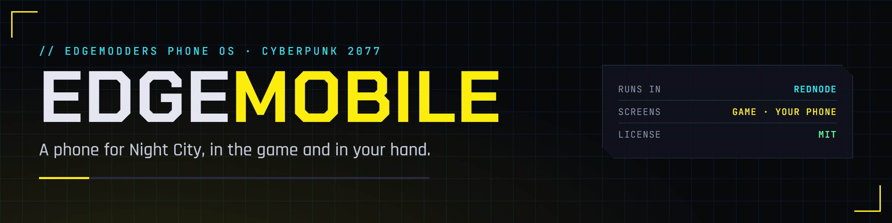

  

  
  
  
  
  

A phone for Night City. EDGEmobile is a phone operating system for Cyberpunk 2077, built as a [REDnode](https://github.com/Edgemodders/REDnode) app. The same phone shows in two places:

- **In the game**, drawn over it by REDnode's overlay, and on the HUD while you play.
- **On your real phone**, as a web app you open by scanning a QR code in the game, and can install to your home screen.

Its home screen shows the mobile apps you install. Other modders can write them. The first will be **Chooms!**, Night City's social feed.

**[Docs](https://edgemodders.github.io/EDGEmobile/)** &middot; [Design](docs/design.md) &middot; [Changelog](docs/changelog.md) &middot; [REDnode](https://github.com/Edgemodders/REDnode)

> [!NOTE]
> **Status: design.** Nothing works yet. The plan and its phases, M1 to M6, are in [docs/design.md](docs/design.md).

## How your phone connects

1. In the game, open EDGEmobile's **Connect a phone**. EDGEmobile starts a free Cloudflare tunnel for you: no Cloudflare account, nothing to type.
2. Scan the QR code with your phone. Your phone shows a pairing code.
3. Check the game shows the same code, and press **Allow**.
4. Your phone shows EDGEmobile's home screen.

The tunnel gives your PC a private web address, and it is locked two ways. A phone gets in only if it scanned the QR code, whose one-time key works once and expires in a minute, **and** you pressed Allow in the game. Anyone else who reaches the address is refused. You can disconnect a phone at any time, and the address closes with the game.

## Repo layout

| Folder | What |
|---|---|
| `edgemobile/` | The EDGEmobile REDnode package: the Node mod (`mod.mjs`), its service for EDGEphone (`service.mjs`), the window for connecting a phone (`connect/`), the OS shell, its themes and fonts (`shell/`), installed mobile apps (`mobile-apps/`) |
| `edgephone/` | The EDGEphone REDnode package: the phone in the game, with the OS from EDGEmobile inside |
| `docs/` | The docs site, published at https://edgemodders.github.io/EDGEmobile/ |
| `tools/` | `deploy.ps1` copies both packages into the game. `brand/render.ps1` renders the banner, icon and badges |

## Install (developers)

1. Deploy [REDnode](https://github.com/Edgemodders/REDnode) to the game.
2. `.\tools\deploy.ps1 -GameDir '<your Cyberpunk 2077 folder>'`

| You need | Why |
|---|---|
| Cyberpunk 2077 on PC with REDnode | EDGEmobile is a REDnode package |
| A phone with a camera and a browser | To scan the QR code and run the phone app. Optional: the phone also shows in the game |

Not affiliated with CD Projekt RED or Cloudflare.
