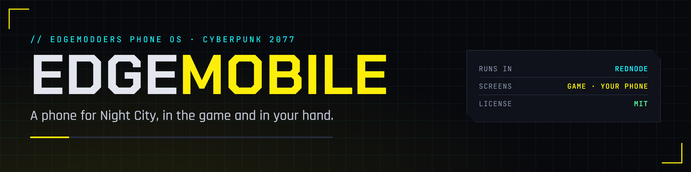
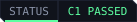
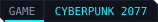
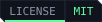

  

  
  
  
  
  

A phone for Night City. EDGEmobile is a phone operating system for Cyberpunk 2077, built as a [REDnode](https://github.com/Edgemodders/REDnode) app. The same phone shows in two places:

- **In the game**, drawn over it by REDnode's overlay, and on the HUD while you play.
- **On your real phone**, as a web app you open by scanning a QR code in the game, and can install to your home screen.

Its home screen shows the mobile apps you install. Other modders can write them. The first will be **Chooms!**, Night City's social feed.

**[Docs](https://edgemodders.github.io/EDGEmobile/)** &middot; [Design](docs/design.md) &middot; [Changelog](docs/changelog.md) &middot; [REDnode](https://github.com/Edgemodders/REDnode)

> [!NOTE]
> **Status: C1 passed, not released yet.** The tunnel, pairing a phone by QR code and the phone's OS work: they passed in the game and on an Android phone (M1 to M3, 2026-10-29 and 10-30; iPhones unverified). Now being built: **Chooms!**, the first mobile app. Its first version (C1, with hand-written posts) passed in the game and on an Android phone on 2026-11-10; next is C2, the game's story. The rest of M4 (a sample app and a guide for modders who write mobile apps) and M5 (installing the app on the phone) are not started. There is no release yet. The plan and its phases, M1 to M6, are in [docs/design.md](docs/design.md).

## How your phone connects

1. In the game, open EDGEmobile's **Connect a phone**. EDGEmobile starts a free Cloudflare tunnel for you: no Cloudflare account, nothing to type.
2. Scan the QR code with your phone. Your phone shows a pairing code.
3. Check the game shows the same code, and press **Allow**.
4. Your phone shows EDGEmobile's home screen.

The tunnel gives your PC a private web address, and it is locked two ways. A phone gets in only if it scanned the QR code, whose one-time key works once and expires in a minute, **and** you pressed Allow in the game. Anyone else who reaches the address is refused. You can disconnect a phone at any time, and the address closes with the game.

## Repo layout

| Folder | What |
|---|---|
| `edgemobile/` | The EDGEmobile REDnode package: the Node mod (`mod.mjs`), its service for EDGEphone (`service.mjs`), the window for connecting a phone (`connect/`), the OS shell, its themes and fonts and the `mobile` library for apps (`shell/`), the mobile apps and their bridge (`server/apps.mjs`, `server/bridge.mjs`) |
| `edgephone/` | The EDGEphone REDnode package: the phone in the game, with the OS from EDGEmobile inside |
| `chooms/` | **Chooms!**, Night City's social feed, the first mobile app: its REDnode package (`chooms/rednode/`: the feed for each playthrough, the settings window) and the mobile app itself (`chooms/mobile/`). Released on its own |
| `docs/` | The docs site, published at https://edgemodders.github.io/EDGEmobile/ |
| `tools/` | `deploy.ps1` copies the packages and Chooms!'s mobile app into the game. `release/zip.mjs` builds the release zips. `brand/render.ps1` renders the banner, icon and badges |

## Install (developers)

There is nothing to compile: the packages are plain JavaScript, HTML and CSS that REDnode runs as they are.

1. Deploy [REDnode](https://github.com/Edgemodders/REDnode) to the game.
2. Close the game, then run `.\tools\deploy.ps1 -GameDir '<your Cyberpunk 2077 folder>'`. The first time, it needs Node.js's `npm` for EDGEmobile's two libraries.

For zips laid out like a release's, run `node tools/release/zip.mjs --draft` (they land in `release/`), or the **Release zip** workflow in GitHub's Actions tab, which keeps them as the run's artifact. Extract them into the game folder.

| You need | Why |
|---|---|
| Cyberpunk 2077 on PC with REDnode | EDGEmobile is a REDnode package |
| A phone with a camera and a browser | To scan the QR code and run the phone app. Optional: the phone also shows in the game |

Not affiliated with CD Projekt RED or Cloudflare.
